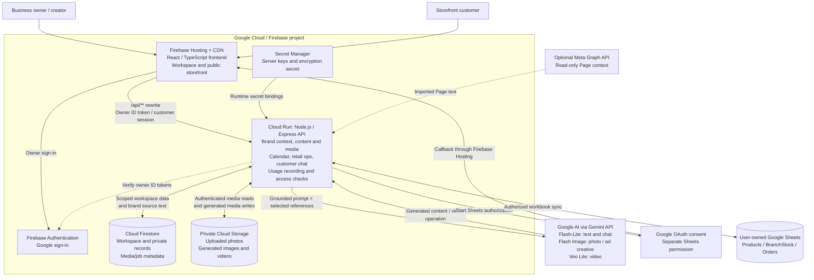
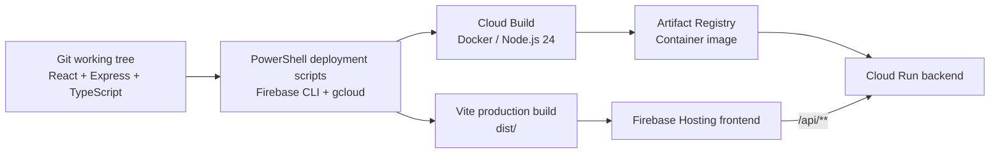

# Asenso One Studio: technology stack and architecture

## Solution

A personal brand and retail operations studio for businesses of one. Owners configure their brand, generate content and product creatives, manage their library and calendar, and handle storefront conversations, products and orders.

This architecture describes the implemented hackathon POC and its deployed Google Cloud/Firebase configuration. The live entry point is https://ai-builder-cup-66e9f.web.app. The application backend is Cloud Run, connected through Firebase Hosting; it is not a Firebase Cloud Function.

## Technology stack

| Layer | Technologies | Responsibility |
| --- | --- | --- |
| Browser application | React 18, TypeScript 5, React DOM | Owner workspace, login and public storefront |
| Navigation | React Router 7 | Client-side routes and storefront Home/Products pages |
| UI | Custom CSS, Lucide React | Responsive layout, icons, accessible forms and controls |
| Frontend build | Vite 6, React Vite plugin | Development server and static production assets |
| Backend runtime | Node.js 24, native ES modules | Production server in the Docker container |
| HTTP API | Express 4, JSON REST endpoints | Owner and public routes, application business rules |
| Validation | Zod 3 | Request schemas and input validation |
| Server build/development | TypeScript compiler, esbuild, tsx | Type checking, backend bundling and local watch mode |
| Environment configuration | dotenv | Local server configuration; developer setup help is opt-in |
| Frontend hosting | Firebase Hosting | HTTPS, static asset CDN, SPA fallback and `/api/**` rewrites |
| Backend hosting | Google Cloud Run | Containerized API in Singapore (`asia-southeast1`) |
| Authentication | Firebase Authentication, Google sign-in, Firebase Web SDK, Firebase Admin SDK | Account creation and server verification of Firebase ID tokens |
| Integration authorization | Google OAuth 2.0, PKCE, google-auth-library, googleapis | Separate Google Sheets consent with offline access |
| AI SDK | Google GenAI SDK (`@google/genai`) | Backend calls to Google AI models |
| Text AI | `gemini-3.1-flash-lite` in the current deployment | Brand guidelines, writing, campaign suggestions and customer replies |
| Image AI | `gemini-3.1-flash-image` | Product-photo and advertising-creative generation using references |
| Video AI | `veo-3.1-lite-generate-preview` | One eight-second 720p video per generation request |
| Brand grounding | Application prompt builder and keyword-ranked document excerpts | Supplies brand guidelines, catalog, approved claims and relevant supporting text to models |
| Primary persistence | Cloud Firestore via Firebase Admin SDK | Workspace records, brand knowledge, drafts, calendar, conversations, orders, usage and media/job metadata |
| Media storage | Private Google Cloud Storage | Uploaded/generated image and video bytes |
| Catalog and retail integration | Google Sheets API, Google Drive OAuth `drive.file` scope | A user-owned workbook containing Products, BranchStock and Orders |
| Optional Page context | Meta Graph API | Read-only Facebook Page details and recent text posts, with a user-supplied Page token |
| Image processing | Sharp | Image validation, orientation, metadata normalization, WebP thumbnails and exact export canvas sizing |
| Document extraction | pdf-parse, native text/JSON handling | Extracts supporting text from PDFs and TXT/MD/CSV/JSON files |
| Secret management | Google Secret Manager | Gemini key, OAuth client secret and session/encryption secret |
| Token/session protection | Node.js crypto, AES-256-GCM, HMAC-SHA256, HTTP-only `__session` cookie | Encrypts integration tokens and binds browser sessions/OAuth state |
| Workspace isolation | Verified UID, SHA-256 workspace identifier, AsyncLocalStorage | Scopes private API requests and storage to the authenticated account |
| Runtime permissions | Google Cloud IAM, dedicated runtime/build service accounts, application default credentials | Authorizes server access to Firestore, private media and secrets |
| Browser media performance | In-memory blob/object-URL cache, request deduplication and a four-request queue | Reuses previews between selections and tabs without persisting private media in browser storage |
| Containers/build infrastructure | Multi-stage Docker build, Cloud Build, Artifact Registry | Builds and stores the backend image before Cloud Run deployment |
| Deployment tools | Firebase CLI, Google Cloud CLI, PowerShell | Combined frontend/backend provisioning and deployment scripts |
| Package management/formatting | npm, package-lock.json, Prettier | Dependency installation, reproducibility and source formatting |
| Existing automated test tooling | Node.js test runner, node:assert, tsx, Playwright | Domain/API tests and browser journeys; not all later enhancements have live or browser coverage |
| Local-only persistence | JSON files and local media files under `.data` | Development fallback; production uses Firestore and GCS |
| Submission artifact tooling | Python, ReportLab, PyMuPDF, Pillow; Playwright recording | PDF deck/contact sheet generation and demo-video capture; separate from the deployed runtime |
| Source control | Git | Local change history and commits |

Additional direct development packages provide TypeScript definitions for Node, Express, React and React DOM. The package manifest also pins an `@grpc/grpc-js` override used by the Google client dependency tree. Exact package resolutions are recorded in `package-lock.json`; models are backend configuration rather than npm dependencies.

## Runtime architecture

Arrows describe logical interactions. Authentication verification uses the Admin SDK and cached signing keys; it does not require a new external Auth API call for every request. The Cloud Run box represents one application service, not separate deployed microservices. Backend persistence and media retrieval remain server-authorized; the browser does not access Firestore or the private bucket directly.

## Deployment architecture

Deployment is run manually through the provided scripts. There is no configured automatic GitHub Actions deployment pipeline.

## Main data flows

1. **Owner access:** Google sign-in returns a Firebase ID token. The backend verifies it and derives the account's workspace scope.
2. **Brand setup:** Saved guidelines, catalog facts, approved claims, extracted documents and optional Page text form the context supplied to generation. This is prompt grounding and text selection, not a separately trained brand model or a vector database.
3. **Creative generation:** An owner uploads/selects an image and configures the creative. The server builds the brief, calls Gemini/Veo, processes image output, stores private media bytes and records metadata/usage. Video operations are persisted and polled without starting a new generation.
4. **Content planning:** Drafts, selected media references and calendar date/time/agendas are saved to Firestore. Planning does not publish to social platforms.
5. **Retail operations:** Owners grant separate Google Sheets access. The app creates its workbook; offering saves sync catalog details, stock sync reads branch stock, and owner order acceptance applies stock changes.
6. **Customer flow:** A storefront session receives answers based on public catalog/brand information. Customers review and confirm an order request; owners decide whether to accept it. Private brand documents and owner media libraries are not exposed through customer chat.
7. **Usage visibility:** Provider token metadata and available cost estimates are stored per workspace. These are app records and planning allowances, not a synchronized Google prepaid balance or an enforced spending cap.

## POC boundaries

- Cloud Run uses one maximum instance and concurrency one because mutation serialization is in process. This architecture is not a claim of production-scale inventory consistency.
- Firestore and Google Sheets do not participate in one transaction. Ambiguous order/stock updates require owner review.
- Firebase Hosting has a 60-second request ceiling. The Firebase deployment sets a 45-second media-provider timeout; a paid generation is never automatically retried.
- The optional Facebook connector imports context; it does not publish posts, run ads or provide live trend analytics.
- The operator's server Gemini key currently serves signed-in users. Login does not create a separate provider billing account for each user.
- Local `.data` content is not automatically migrated when deploying.
- The frontend and backend have been deployed. Full interactive sign-in, Sheets consent and live paid generation are separate checks from the completed deployment endpoint checks.

## Implementation references

- Dependencies and commands: `package.json`, `package-lock.json`
- Browser application: `src/`
- API, grounding, storage and integrations: `server/`
- Hosting routes: `firebase.json`
- Container/runtime: `Dockerfile`, `deploy.ps1`
- Combined deployment: `scripts/deploy-firebase.ps1`
- Operational details: `DEPLOYMENT.md`
